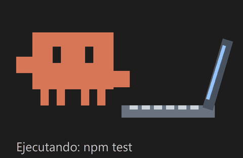

# Clawd estresado



Un mod para Claude Code que pone a Clawd encima de la caja de texto, tecleando en su laptop mientras Claude trabaja. Si el turno se complica (fallan herramientas, Claude tiene que preguntarte algo, el trabajo se alarga) Clawd se pone nervioso y, si la cosa empeora, se golpea la cabeza contra el teclado. Cuando pasa un rato sin errores, se calma solo.

Al lado de Clawd aparece en todo momento lo que Claude está haciendo: `Pensando…`, `Leyendo app.ts`, `Ejecutando: npm test`, `Escribiendo la respuesta…`, etc.

## Instalación

En la línea de comandos de una sesión de Claude Code en la terminal:

```
/plugin install clawd-estresado --marketplace lautarocuelllo-bit/clawd-estresado
```

Responde `y` para añadir el marketplace y elige el alcance (con el de usuario se carga en todas tus sesiones).

Desde una shell:

```bash
claude plugin install clawd-estresado --marketplace lautarocuelllo-bit/clawd-estresado
```

En la app de escritorio, donde `/plugin` no funciona: pulsa **+** junto a la caja de texto, luego **Plugins**, **Add marketplace** con `lautarocuelllo-bit/clawd-estresado`, y después **Add plugin**.

## Comandos

- `/clawd test`: Clawd recorre todos sus estados durante 15 segundos y se calma.
- `/clawd`: oculta o vuelve a mostrar a Clawd.

## Cuándo se estresa

Cada fallo de una herramienta, o cada pregunta que Claude te hace, suma 2 puntos durante 30 segundos y 1 punto otros 30; después deja de contar. Un turno de 2 minutos o más suma 1 punto, y uno con 20 herramientas o más, otro.

| Puntos | Clawd |
| --- | --- |
| Sin turno en marcha | Tranquilo, flota y parpadea |
| 0–1 | Teclea |
| 2–3 | Nervioso: ojos grandes, gota de sudor, se balancea |
| 4 o más | Se da cabezazos contra la laptop |

Si un turno termina con un error, Clawd se da cabezazos durante 5 segundos.

En la app de escritorio Clawd es un dibujo animado; en la terminal es una versión en texto de una línea.

## Desarrollo

```bash
claude plugin validate .
claude plugin test .
```

Este mod usa la API de hooks de función de Claude Code, que está en acceso anticipado y puede cambiar entre versiones.

## Aviso

Este es un mod hecho por fans. No es un producto oficial de Anthropic ni está afiliado, patrocinado o respaldado por Anthropic. Clawd y Claude son de Anthropic; aquí Clawd aparece redibujado como homenaje.

## Licencia

[MIT](LICENSE). La licencia cubre el código de este mod, no el personaje ni las marcas de Anthropic.
